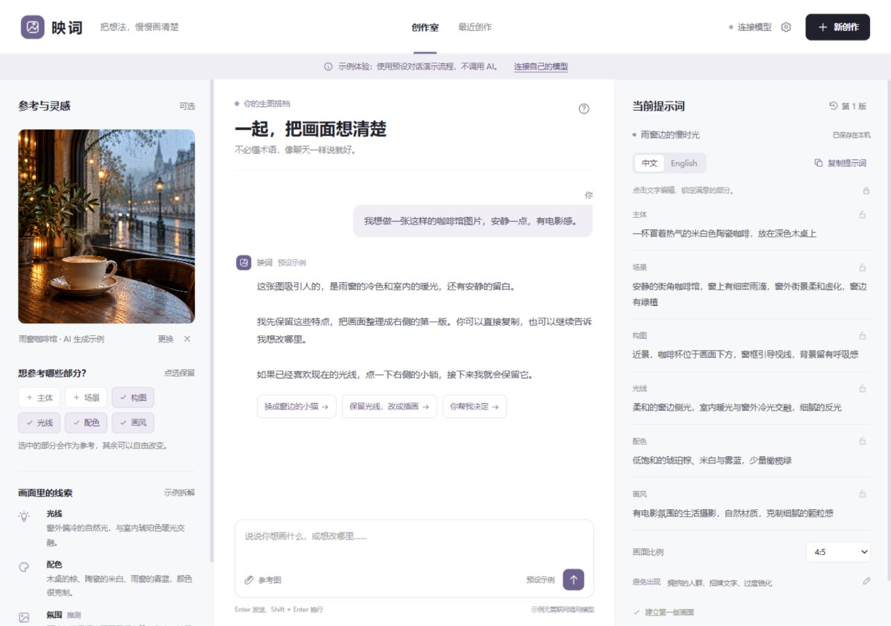

# 映词 · Yingci

**把想法，慢慢画清楚。** 一个面向普通人的生图提示词助手：上传参考图，用日常语言说想法，一起整理、修改并保留满意的画面要素。

> 当前为 v0.1.0 本机首版。自带明确标注的预设示例；自由对话和图片理解需要连接自己的视觉模型。应用本身不生成图片。



## 开始使用

安装 [Node.js](https://nodejs.org/) 22.13 或更高版本，无需安装 npm 依赖。

```sh
git clone https://github.com/xngsgs/yingci.git
cd yingci
npm start
```

打开终端输出的本机地址，默认 **http://127.0.0.1:4328**。Windows 用户也可以双击 `启动映词.cmd`。

1. 点击示例建议，体验连续修改提示词。
2. 点击“连接模型”，填写服务商提供的接口基础地址、视觉模型 ID 和 API Key。
3. 可先“测试连接”，再保存。连接测试只验证文字请求，不保证模型的图片理解能力。
4. 新建创作，上传图片或描述想法。喜欢的要素可以锁定；提示词支持中英切换、编辑、复制、导出和版本恢复。

模型接口采用 Chat Completions 兼容格式，支持 `image_url` 的 Base64 图片输入。可连接支持这一协议的云端视觉模型，或本机兼容服务（例如已运行并下载视觉模型的 Ollama）。不同服务的模型名称、接口地址、结构化输出能力和用量规则不同，请使用其官方文档中的实际值。

- [官方 OpenAI 图片理解文档](https://developers.openai.com/api/docs/guides/images-vision)
- [千问图片理解文档](https://help.aliyun.com/zh/model-studio/vision/)

也可复制 `.env.example` 为 `.env`，设置 `AI_BASE_URL`、`AI_MODEL`、`AI_API_KEY` 和可选的 `PORT`。在界面保存过连接配置后，本机 `.local/provider.json` 优先于环境变量。需要回到环境变量配置时，停止服务并自行移走这份本机配置文件。

## 可以做什么

- 图片参考可选择主体、场景、构图、光线、配色和画风；上传时在浏览器里缩小到最长边 1600px，并转成 JPEG，透明区域会填白。
- 自然对话完善画面；系统提示要求每轮最多提两个关键问题，并区分可见观察与推测。
- 六个要素采用中英文结构化状态，服务端强制保留锁定字段，再从状态组合提示词。
- 每次 AI 回应、手动编辑和恢复都保留版本；恢复产生新版本，不覆盖历史。
- 创作记录以 JSON 文件原子保存到本机 .local/projects/，刷新或更换浏览器仍能读取。
- 示例仅接受界面给出的预设选项，任意输入需要真实模型；不会用模板冒充图片分析。

## 数据与边界

- 这是**单用户本机应用**，默认只监听 `127.0.0.1`。没有多用户身份隔离，不适合直接公开部署。
- 密钥保存在本机 `.local/provider.json` 或环境变量中，不返回浏览器、不进入对话，不写入 Git。配置文件为本机明文，请保护本机账户权限。
- 用户点击发送后，当前参考图、最近最多 24 条对话消息、画面要素与锁定状态会发送给所连接的模型服务。发送前会在界面提示。
- 图片和聊天记录保存在本机 .local/projects/，不上传到 GitHub。存储失败会在界面显示；完整备份可复制 .local 目录，重要提示词也可单独导出。
- 提示词不能确定性还原参考图，也无法从图片确定原始 prompt、seed 或生成模型。输出为可编辑的自然语言提示词，不含特定生图工具的专属参数。
- 模型有时会返回错误格式、产生不准确分析，或忽略未锁定的偏好。程序会拒绝无效状态；模型质量仍需用真实案例评估。
- 测试使用模拟服务验证协议和规则，**不代表真实模型质量或真实供应商联调已完成**。

## 开发

```sh
npm run check
npm test
npm run dev
```

无需打包步骤。前端为原生 ES Modules 和 CSS；后端使用 Node.js 内置 HTTP、Fetch 与文件 API。没有运行时第三方依赖。

```
public/          界面、示例、状态模型、浏览器存储
src/provider.mjs 模型协议、提示策略和输入校验
src/config.mjs   本机密钥配置与原子保存
src/server.mjs   回环 HTTP 服务与 API
test/            模型契约、锁定、配置和 HTTP 测试
docs/            设计、验证记录与资产说明
```

## 下一步验证

优先用真实生图需求比较：直接对聊天 AI 提问、使用映词，两种方式各需要几轮修改，是否保留满意的决定。多模型预设、生成结果反馈和更多自动化应基于这些结果逐步加入。

代码使用 MIT License。示例照片由 AI 生成，来源与生成提示见 [资产说明](docs/ASSETS.md)。
